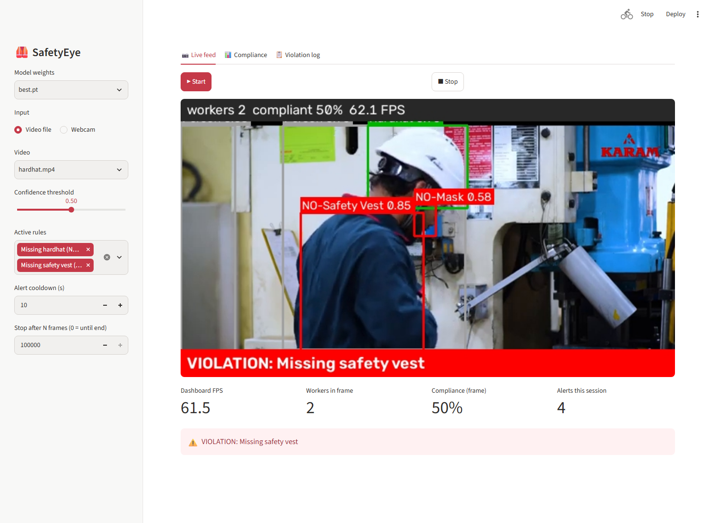
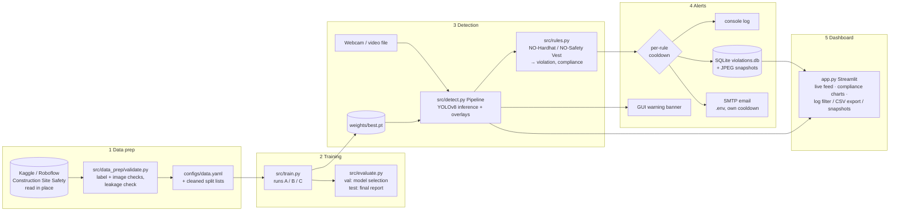
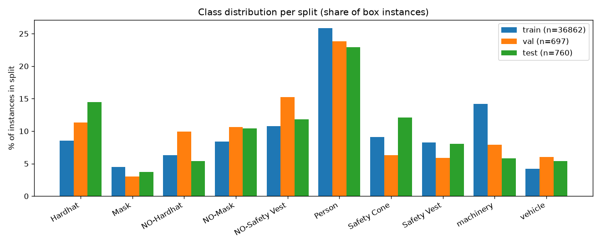
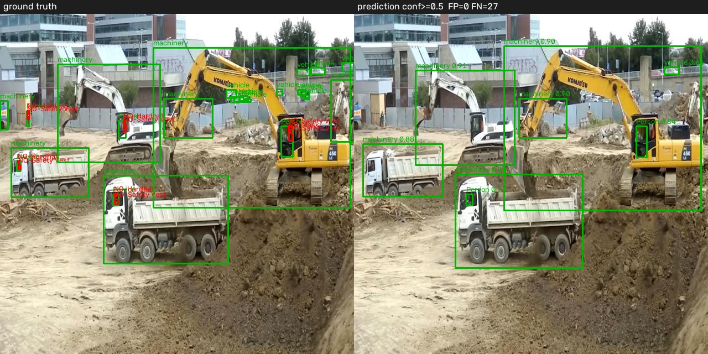

# SafetyEye – AI-Powered Workplace Occupancy & Safety Monitor

Detects missing PPE (hardhat, safety vest, optionally mask) in a webcam or video stream with a fine-tuned YOLOv8 model.
It raises console, SQLite, snapshot and email alerts and shows live compliance on a Streamlit dashboard.
Built for the Infosys Springboard brief (modules: Data Prep → Model Train → Detection → Alerts → Dashboard).



## Architecture



### Safety rules
The dataset labels violations explicitly with negative classes, so the rules use those classes directly:

| Dataset class | Rule | Default |
|---|---|---|
| `NO-Hardhat` | Missing hardhat | on |
| `NO-Safety Vest` | Missing safety vest | on |
| `NO-Mask` | Missing mask | off (enable with `--rules` / the sidebar) |

Each violation box is attached to the `Person` box that contains at least 50% of it. A person with one or more violations is
non-compliant. A violation with no matching person still counts as one non-compliant worker. Frame compliance =
compliant workers / workers. Alerts for the same rule are suppressed for `--cooldown` seconds (default 10 s), and emails have
their own 300 s cooldown. See [src/rules.py](src/rules.py) and the tests in [tests/test_rules.py](tests/test_rules.py).

## Dataset

Kaggle "Construction Site Safety Image Dataset (Roboflow)" (snehilsanyal), a Roboflow Universe export, v28, licensed CC BY 4.0.
It is read in place from `SAFETYEYE_DATASET` (default `C:/Users/acer/Desktop/DataSet/css-data`) and is **not** in this repo.

- 10 classes, names taken from the YAML shipped with the dataset: `Hardhat, Mask, NO-Hardhat, NO-Mask, NO-Safety Vest,
  Person, Safety Cone, Safety Vest, machinery, vehicle`. The `css-data/` folder itself has no data.yaml.
- Images: train 2605, valid 114, test 82 (all 640×640). Already in YOLO format.
- Roboflow pre-applied augmentation to train: 5 copies per source image, plus some 2×2 mosaics with cutout squares.
- **Validation result** ([log](results/raw/data_validation.txt)): no corrupt images and no missing or orphan labels. 2 train
  label files contain duplicate boxes and were excluded (2603 train images kept). 24 images have empty labels (backgrounds, kept).
- **Splits**: the dataset's own train/valid/test splits are used. Re-splitting would scatter Roboflow's augmented copies of one
  photo across splits (leakage). 8 file stems are shared across splits, but a pixel comparison shows they are different
  photos with colliding names ([log](results/raw/leakage_visual_check.txt)).
- Class distribution: [results/data_report/class_distribution.csv](results/data_report/class_distribution.csv), 

## Results (all numbers measured; links go to the raw command output)

**Hardware:** NVIDIA GeForce RTX 3050 Ti Laptop GPU (4 GB), Intel Core i5-12500H, 15.7 GB RAM, Windows 11,
Python 3.11.9, torch 2.6.0+cu124, ultralytics 8.4.220.

### Training runs and model selection (validation split, 114 images / 697 boxes)

Shared settings: 50 epochs, imgsz 640, batch 16, seed 0, `deterministic=True`, SGD lr0 0.01, COCO-pretrained start.

| Run | Model | Augmentation | Train time | P | R | mAP@0.5 | mAP@0.5:0.95 |
|---|---|---|---:|---:|---:|---:|---:|
| A | YOLOv8n | Ultralytics default | 50.9 min | 0.885 | 0.685 | 0.767 | 0.455 |
| B | YOLOv8n | stronger: rotation ±5°, scale 0.7, mixup 0.15 | 68.2 min | 0.874 | 0.653 | 0.737 | 0.375 |
| **C** | **YOLOv8s** | Ultralytics default | 103.2 min | **0.907** | **0.770** | **0.842** | **0.563** |

**C was selected on validation mAP** and is the only model evaluated on the test split. Details, including why B lost, are in
[results/tuning_comparison.md](results/tuning_comparison.md). Training logs: [A](results/raw/train_A_v8n_default_aug.txt),
[B](results/raw/train_B_v8n_strong_aug.txt), [C](results/raw/train_C_v8s_default_aug.txt). Curves, confusion matrices and
results.csv are in [results/train/](results/train/).

### Test split – selected model C (YOLOv8s), 82 images / 760 boxes

Source: [results/raw/eval_test_C_v8s_default_aug.txt](results/raw/eval_test_C_v8s_default_aug.txt) and
[metrics.json](results/eval/test_C_v8s_default_aug/metrics.json). Ultralytics val with conf 0.001 and IoU 0.7. P and R are at the
confidence threshold that maximises mean F1.

| Class | Instances | Precision | Recall | mAP@0.5 | mAP@0.5:0.95 |
|---|---:|---:|---:|---:|---:|
| **all** | 760 | 0.911 | 0.728 | **0.790** | **0.498** |
| Hardhat | 110 | 0.979 | 0.850 | 0.931 | 0.609 |
| Mask | 28 | 0.955 | 0.759 | 0.781 | 0.550 |
| NO-Hardhat | 41 | 0.864 | 0.618 | 0.591 | 0.314 |
| NO-Mask | 79 | 0.882 | 0.722 | 0.801 | 0.404 |
| NO-Safety Vest | 90 | 0.943 | 0.741 | 0.809 | 0.503 |
| Person | 174 | 0.937 | 0.799 | 0.879 | 0.569 |
| Safety Cone | 92 | 0.814 | 0.457 | 0.486 | 0.234 |
| Safety Vest | 61 | 0.899 | 0.885 | 0.903 | 0.606 |
| machinery | 44 | 0.938 | 0.818 | 0.877 | 0.676 |
| vehicle | 41 | 0.903 | 0.634 | 0.844 | 0.516 |

At conf ≥ 0.5 with greedy same-class IoU ≥ 0.5 matching, the test split has 25 false positives and 216 false negatives over
760 ground-truth boxes. 43 of 82 images have zero errors. Most errors are misses, not false alarms. Sample predictions
(ground truth left, prediction right), including the 6 worst images: [results/eval/test_C_v8s_default_aug/samples/](results/eval/test_C_v8s_default_aug/samples/).
The worst image is a racing-car scene with about 40 tiny distant cones. Only 8 test images contain cones, which is why Safety Cone scores low.



### Real-time latency / FPS

Input: `hardhat.mp4` from the dataset's `source_files` folder (640×360, 29.97 fps). Measured over 500 frames after 20 warm-up frames.
End-to-end covers frame decode, YOLO pre-processing, inference and post-processing, the rule engine, drawing the overlay and alert
handling (SQLite and snapshot). Display is excluded. Script: [scripts/benchmark_latency.py](scripts/benchmark_latency.py).

| Model | Device | Throughput | End-to-end mean / p95 | YOLO inference mean | Raw log |
|---|---|---:|---:|---:|---|
| **YOLOv8s (selected)** | RTX 3050 Ti Laptop GPU | **96.1 FPS** | **10.4 / 12.9 ms** | 7.6 ms | [log](results/raw/benchmark_C_v8s_default_aug_gpu.txt) |
| YOLOv8n (run A) | RTX 3050 Ti Laptop GPU | 115.4 FPS | 8.7 / 13.0 ms | 5.9 ms | [log](results/raw/benchmark_A_v8n_default_aug_gpu.txt) |
| YOLOv8s (selected) | i5-12500H CPU | 11.2 FPS | 89.7 / 98.1 ms | 85.9 ms | [log](results/raw/benchmark_C_v8s_default_aug_cpu.txt) |

The rule engine takes 0.01 ms per frame. Inside the Streamlit dashboard the displayed FPS was about 60–62 (screenshot), because
browser image streaming adds overhead. On GPU the pipeline runs faster than the video's 29.97 fps. On CPU it does not.

### Tests
29 pytest tests pass ([log](results/raw/pytest.txt)): label validation and corrupt-file handling, the rule engine (compliance,
person association, thresholds, cooldown), and alerts (SQLite log and queries, snapshots, cooldown, email with a mocked
SMTP server, email failure handling).

## Not measured / limitations

- **The violation rule engine's accuracy on real footage was not measured.** No labelled video was available. Only per-box
  detection metrics on still images (above) and the rule logic's unit tests exist.
- No webcam was used. All real-time numbers come from the video file above.
- **Real email sending was not tested.** SMTP is tested only with a mock. Set the `.env` values (Gmail needs an App Password)
  to try it.
- The val (114 images) and test (82 images) splits are small. Some classes have few test images (Mask 28 boxes; Safety
  Cone only 8 images), so per-class numbers are noisy. Each tuning setting was run once (seed 0) and no variance was measured.
- Recall for `NO-Hardhat` (0.618 on test) means about 4 in 10 bare heads are missed. That's not good enough to be the only safety control.
- Tuning was a 3-run comparison, not a systematic search. YOLOv8m and larger image sizes were not tried (4 GB GPU).
- Dashboard compliance percentages describe the demo video, not a measured model metric.
- The bundled `results_yolov8n_100e/` Kaggle notebook output in the dataset folder is someone else's run. None of its numbers are used.

## Setup

```powershell
py -3.11 -m venv .venv; .venv\Scripts\activate
pip install torch torchvision --index-url https://download.pytorch.org/whl/cu124   # GPU build
pip install -r requirements.txt
copy .env.example .env      # set SAFETYEYE_DATASET; optional SMTP settings
```

## Run

```powershell
python -m src.data_prep.validate                                   # M1: validate dataset, write configs/data.yaml
python -m src.train --config configs/train_baseline.yaml           # M2: run A (also train_B_strong_aug.yaml, train_C_v8s.yaml)
python -m src.evaluate --weights weights/C_v8s_default_aug.pt --split val  --name val_C
python -m src.evaluate --weights weights/C_v8s_default_aug.pt --split test --name test_C --samples
copy weights\C_v8s_default_aug.pt weights\best.pt
python -m src.detect --weights weights/best.pt --source 0          # M3: webcam (or a video path); q to quit
streamlit run app.py                                               # M4/M5: dashboard
python scripts/benchmark_latency.py --weights weights/best.pt --video <video.mp4> --device 0
pytest -q
```
Wrap any command in `python scripts/run_logged.py <name> -- <command>` to save the command and its full output to `results/raw/`.

## Repository layout
```
src/data_prep/validate.py  dataset checks, leakage check, data.yaml, class report
src/train.py               training (configs/train_*.yaml)
src/evaluate.py            metrics per split, per-class tables, sample predictions
src/rules.py               violation rules, compliance, cooldown
src/detect.py              real-time pipeline (webcam/video), overlays, GUI warning
src/alerts.py              console + SQLite + snapshot + SMTP alerts
app.py                     Streamlit dashboard
scripts/                   benchmark, logged-run wrapper, dashboard screenshots
tests/                     pytest
results/                   committed metrics, curves, raw logs
```
Not committed: the dataset, `weights/*.pt`, `runs/`, videos, `violations/` (runtime DB and snapshots) and `.env`.

## License

Ultralytics YOLOv8 is **AGPL-3.0**. Using or distributing this project, including as a network service, carries AGPL
obligations unless you hold an Ultralytics Enterprise license. The dataset is CC BY 4.0. See [LICENSE-NOTES.md](LICENSE-NOTES.md).
